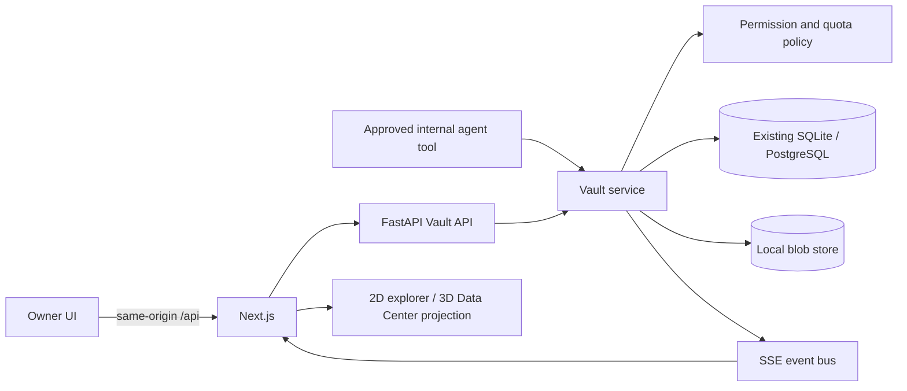

# NEXUS AI — Data Center & Digital Vault

This document is the architecture and delivery tracker for the **Data Center & Digital
Vault** feature. It is a separate, approval-gated feature track named **DC-1** through
**DC-8** so that it cannot be confused with NEXUS AI's existing 16-stage roadmap.

> **Current status:** DC-3 was completed on 2026-10-09 and is awaiting approval for
> DC-4. The global product remains at **Stage 10 of 16**, with Stage 11 unapproved. The
> 3D room, live metadata projection and owner file APIs are operational; the browser
> explorer is not.

## Product contract

The completed feature will provide persistent, backend-managed artifacts for every
department and expose them through both a professional 2D file explorer and an
interactive 3D server room. The following rules apply to every DC stage:

- File names, contents, counts, sizes, quotas and activity must come from real backend
  state. Decorative racks and LEDs are never evidence of a storage operation.
- Binary contents live in a storage backend; searchable metadata and relationships live
  in the existing database. The browser is never the system of record.
- Department workspaces are derived from the `departments` table, not from a hardcoded
  list. A future department must receive the same storage behavior automatically.
- The frontend receives opaque IDs and safe metadata, never arbitrary server paths or
  storage keys.
- Uploading or previewing a file never executes it. Generated applications continue to
  use the existing owner-approved Bubblewrap runtime.
- Permissions, quotas, approvals and permanent deletion are enforced in backend code.
- Local storage is the first supported backend. S3-compatible and network storage are
  extension points, not features that are currently claimed.

## Feature stage tracker

Only one DC stage may be executed at a time. Each stage must be implemented, tested and
reported, then stop for the owner's approval before the next one begins.

| ID | Scope | Status |
| --- | --- | --- |
| DC-1 | Project inspection, storage architecture, configuration and schema foundation | ✅ Complete |
| DC-2 | Visible 3D Data Center room, 2D fallback and backend-connected read-only overview | ✅ Complete |
| DC-3 | Real storage backend: upload, download, folders, rename, move, trash and validation | ✅ Complete — awaiting approval for DC-4 |
| DC-4 | Dynamic department workspaces, quotas, permissions and task/app associations | ⏳ Not started; requires approval after DC-3 |
| DC-5 | Professional file explorer, search, previews, metadata and ZIP export | ⏳ Not started |
| DC-6 | Automatic registration of real AI employee artifacts | ⏳ Not started |
| DC-7 | Engineering project viewer, immutable versions, restore, diffs and dashboards | ⏳ Not started |
| DC-8 | Backup/recovery, integrity, permission boundaries, performance and final polish | ⏳ Not started |

DC stages do not advance `CURRENT_STAGE` in `frontend/src/lib/stages.ts` and do not
approve global Stage 11. If the owner later replaces or reschedules the 16-stage plan,
that is a separate explicit decision.

## Existing systems to preserve

The Vault must integrate with the current sources of real files rather than create a
parallel demo system:

| Existing source | Current persistence | DC integration decision |
| --- | --- | --- |
| Chat attachments | Bytes and decoded text in the `attachments` table; 2 MiB limit | Keep the current source intact. A later adapter may register an attachment in the Vault without changing chat history. |
| Engineering apps | Versioned text in `app_files`; runtime materialized under `NEXUS_APPS_DIR` | `App` and `AppVersion` are the current engineering project aggregate. Vault links must retain app and version provenance. |
| Code-run outputs | Files under `NEXUS_RUNS_DIR/<run id>/files` plus metadata on `code_runs` | Register only files that really exist and retain the originating run/task/employee. |
| Tasks and workflows | Database-backed tasks, assignees, departments and results | Artifacts link to their real task and creator; failed generation creates no fake successful file. |
| Departments | Twenty seeded rows in the `departments` table | Workspaces are provisioned from database rows and remain dynamic. |

There is no general `Project` model yet; it belongs to global Stage 11. DC-1 therefore
must not introduce a competing project system. Initial links use the existing `Task`
and engineering `App`/`AppVersion` records. A proper project foreign key can be added
when the canonical project model exists.

## Architecture

The service layer is the only component allowed to combine metadata and blob
operations. API routes, agent tools and future background jobs all call the same
service and policy checks.

### Configuration contract

DC-1 implements the following server-side environment variable names. All sizes are
bytes so configuration is unambiguous.

| Variable | Default | Purpose |
| --- | --- | --- |
| `NEXUS_STORAGE_BACKEND` | `local` | Selected blob backend. DC-1 accepts only `local`; unsupported values must fail configuration instead of pretending cloud storage works. |
| `NEXUS_STORAGE_ROOT` | `backend/var/storage` | Private root for temporary and committed blobs. It is ignored by git. |
| `NEXUS_STORAGE_MAX_FILE_BYTES` | `104857600` (100 MiB) | Hard per-file upload/write limit, enforced while streaming. |
| `NEXUS_STORAGE_DEPARTMENT_QUOTA_BYTES` | `10737418240` (10 GiB) | Default logical quota per department; it does not reserve disk space. |
| `NEXUS_STORAGE_ALLOWED_EXTENSIONS` | The documented initial file types | Comma-separated extension policy. MIME and extension are advisory metadata; neither authorizes execution. |
| `NEXUS_STORAGE_BACKUP_ROOT` | unset | Optional local backup destination. Unset means backups are not configured. A folder on the same drive is not described as disaster recovery. |

`NEXUS_STORAGE_ROOT` and `NEXUS_STORAGE_BACKUP_ROOT` must be distinct and must not be
nested inside one another. A maximum file size cannot exceed the department quota.
Secrets never belong in these settings or in file metadata returned to the browser.

### Metadata schema foundation

Migration `0013_storage_foundation` adds the structures without creating or copying
user files:

- **`storage_workspaces`** — one company workspace plus one row for every department
  selected from the real registry during migration. The department foreign key is
  unique and restrictive, with optional quota override and active/read-only state.
- **`storage_entries`** — logical folders/files with opaque IDs, workspace/parent,
  case-preserving path, NFKC/case-folded `path_key`, type, description, visibility,
  creator/owner snapshots, current version number, failure state and Trash metadata.
  `(workspace_id, path_key)` is unique, avoiding nullable-root uniqueness differences.
- **`storage_versions`** — version records with `(entry, number)` uniqueness, opaque
  storage key, byte size, SHA-256, MIME type, change description, creator and integrity
  state. Blob creation itself begins in DC-3.
- **`storage_links`** — idempotent provenance links to tasks, workflows, apps, app
  versions/files, code runs, messages and the future canonical project model.
- **`storage_tags`** — normalized, case-insensitive tag keys for portable search.
- **`storage_grants`** — department/employee read, write or manage grants with grantor,
  expiry and revocation history. Enforcement begins with the service layer in DC-3/DC-4.
- **`storage_events`** — append-only audit/failure records whose actor snapshots survive
  employee or artifact removal.

The models and migration stay in the existing Alembic single-head sequence and are
covered by drift plus upgrade/downgrade testing.

### Blob layout and atomic writes

Department and original file names are metadata, not operating-system paths. Local
blobs use opaque keys below the configured root. A write is designed to:

1. stream into a uniquely named temporary file while enforcing the size limit;
2. calculate the checksum without loading the whole file into memory;
3. flush and atomically rename the complete blob into its final opaque location;
4. commit the corresponding metadata/version/event transaction; and
5. leave a failed operation unavailable to users and eligible for safe orphan cleanup.

The filesystem and SQL database cannot share one atomic transaction. Immutable blobs,
explicit operation states and reconciliation make that boundary observable instead of
silently reporting success. No download endpoint accepts a filesystem path. DC-1's
logical-name layer rejects absolute paths, drive/UNC paths, `..` and NUL bytes; DC-3's
local backend must additionally reject symbolic-link traversal.

### Permission boundary

NEXUS currently has no login or multi-user identity system. Browser requests are
treated as the local company owner, and opt-in LAN mode already warns that anyone on
the trusted network can use the application. Consequently:

- DC stages can enforce owner-versus-agent permissions and department scoping inside
  the backend service.
- Agent tools receive an internal actor context; callers cannot choose an arbitrary
  employee ID to impersonate.
- Full human multi-user RBAC and safe use on an untrusted network require a future
  authentication decision. They must not be claimed merely because buttons are hidden.
- Finance, HR, Legal and Sales data remain restricted from unrelated agents by backend
  policy. Preview/search/model-context operations use the same policy as downloads.

Permanent deletion and cross-department sharing are audited, backend-gated actions.
Normal deletion moves an item to Trash. Private storage keys and absolute locations are
never included in API responses, logs or model prompts.

## UI direction from the supplied reference

The owner-supplied **Web App Sandbox Interface Overview** is a visual reference, not a
completed NEXUS screen. DC-2 begins applying its visual language; future DC-5/DC-7 work
should carry forward these qualities:

- a premium dark workspace with restrained blue-to-purple accents and high-contrast
  typography consistent with the existing NEXUS design tokens;
- a persistent tree/navigation pane, a focused main workspace and a dedicated preview
  or metadata pane rather than overlapping modal windows;
- unmistakable status badges such as **Isolated**, **Online**, **Ready** or **Failed**,
  backed by real backend state;
- a short, visible lifecycle from upload/create through validation and preview to a
  deliberate download or release action;
- prominent safety context and compact operational controls, with destructive actions
  separated from ordinary navigation;
- polished empty, loading, unavailable and failure states instead of sample files or
  fabricated terminal output.

The Vault adapts that composition to storage: the left side becomes All Files,
Departments, Projects, Recent, Favorites, Shared, Archives and Trash; the center uses
grid/list browsing; the right side shows safe preview, metadata, versions, provenance
and activity. On smaller screens the 2D explorer remains usable without the 3D room.

The reference's live browser preview and terminal are shown only for a real engineering
app running through the existing isolated runtime. An ordinary uploaded HTML or SVG is
never executed to make the interface look functional. If no runtime exists, the UI
says **Preview unavailable — runtime not configured.**

## DC-1 verification

All checks ran in the isolated `~/nexus-ai-dev` WSL copy with temporary databases and
storage roots; the owner's running `~/nexus-ai` data and real providers were not used.

| Check | Result |
| --- | --- |
| Storage configuration, logical paths and migration foundation | **PASS** — 25 tests |
| Complete backend suite | **PASS** — 246 passed, 4 skipped |
| Backend Ruff; frontend ESLint and TypeScript | **PASS** |
| Frontend unit suite | **PASS** — 183 tests |
| Next.js production build | **PASS** — 20 routes generated |
| Isolated full-stack smoke test | **PASS** — pages, APIs, proxy failure and SSE |
| Playwright browser suite | **FAIL** — 51 passed; the existing employee walk test stayed `walking` instead of reaching `away` under software GL. The isolated test failed the same way on a second run; normal GPU flags could not initialize the WSL office. No DC-1 frontend/3D code changed. |

DC-3 adds streaming size/quota enforcement, atomic blob commits, missing/corrupt blob
reconciliation and symlink-safe local storage tests; DC-1/DC-2 did not claim those file
operations existed.

## DC-2 implementation

- Level 2 now contains a dedicated **Data Center** beside Engineering, separated by a
  glass wall and enterable door. It is part of the same room model, camera controls,
  room search, accessible 2D plan and responsive details panel as every other room.
- Twelve rack meshes form the physical room. Their lighting is explicitly ambient; it
  does not claim per-rack health or storage activity.
- `GET /api/storage/overview` returns aggregate workspace, entry, version, byte, quota,
  backup-configuration and latest-event facts from the real database and settings. It
  never returns file names, contents, storage keys or server paths.
- The room panel shows loading, live, empty and backend-unavailable states. The Digital
  Vault action is visibly disabled because file operations do not exist yet.
- Engineering retains all twelve workstation IDs and therefore preserves existing
  employee desk assignments while fitting within its resized room.

## DC-2 verification

Backend and full-stack verification runs in the isolated WSL development copy with
temporary databases, storage roots and fake providers. Frontend-only checks run from
the shared working tree.

| Check | Result |
| --- | --- |
| Storage overview and storage-foundation tests | **PASS** — 27 tests |
| Complete backend suite | **PASS** — 248 passed, 4 skipped |
| Backend Ruff; frontend ESLint and TypeScript | **PASS** |
| Frontend unit suite | **PASS** — 188 tests |
| Next.js production build | **PASS** — 21 routes generated |
| Isolated full-stack smoke test | **PASS** — including direct and proxied storage overview |
| Data Center browser flow and screenshot | **PASS** — room selection, live metadata, read-only states and disabled file operations |
| Full Playwright browser suite | **PARTIAL** — 52 passed and 2 failed on the first full software-GL run. The new character-click regression was fixed and its focused rerun passed. The remaining pre-existing suspended-walk test again stayed `walking` instead of reaching `away`; its exact isolated rerun failed identically. |

## DC-3 implementation

`VaultService` is now the transaction boundary for owner file operations, and
`LocalBlobStore` is the only component that handles local object paths. The API surface
is intentionally backend-first so DC-4 permissions and DC-5's explorer can use the same
enforced operations instead of duplicating storage logic.

| Route | Behavior |
| --- | --- |
| `GET /api/storage/workspaces` | Real workspace usage, state and effective quota |
| `GET /api/storage/workspaces/{id}/entries` | Safe logical entry metadata; never storage keys or server paths |
| `POST /api/storage/workspaces/{id}/folders` | Create a validated logical folder |
| `POST /api/storage/workspaces/{id}/files` | Stream and atomically commit one allowlisted upload |
| `GET /api/storage/entries/{id}/download` | Revalidate size/SHA-256 and stream with `nosniff` |
| `PATCH /api/storage/entries/{id}` | Rename or move a file/folder and update descendant paths |
| `DELETE /api/storage/entries/{id}` | Move the complete logical subtree to Trash without deleting blobs |
| `POST /api/storage/entries/{id}/restore` | Restore a trashed subtree when its parent is available |
| `POST /api/storage/maintenance/reconcile` | Mark missing/corrupt versions and report orphaned/unsafe objects without deleting uncertain data |

Uploads stream to a unique private temporary file, enforcing the lower of the per-file
limit and remaining workspace quota while computing SHA-256. The completed file is
flushed and atomically moved to an internally generated key before metadata, version and
audit rows commit together. A failed metadata commit removes the new blob; interrupted
or oversized streams remove their temporary file. Reconciliation covers the unavoidable
filesystem/database crash boundary.

Logical paths remain NFKC-normalised and case-insensitively unique. The local backend
accepts only generated key shapes, refuses symbolic links and non-regular files, and
never follows a browser path. Read-only workspace state, extension policy, folder-cycle
prevention, byte limits and quota limits are enforced in the service rather than the UI.

The Data Center panel now reports that the storage owner API is operational while its
disabled action accurately says the browser explorer is planned for DC-5.

## DC-3 verification

Backend and full-stack verification use the isolated WSL development copy with temporary
databases, storage roots and fake providers. Frontend-only checks use the shared working
tree.

| Check | Result |
| --- | --- |
| Storage lifecycle, limits, integrity and symlink tests | **PASS** — 15 focused tests |
| Complete backend suite | **PASS** — 255 passed, 4 skipped |
| Backend Ruff; frontend ESLint and TypeScript | **PASS** |
| Frontend unit suite | **PASS** — 188 tests |
| Next.js production build | **PASS** — 21 routes generated |
| Isolated full-stack smoke test | **PASS** — real upload, byte-identical download and Trash plus pages, proxy, SSE and backend-down behavior |
| Clean-checkout setup, migrations and smoke test | **PASS** — reproduced from the exact staged tree with fresh dependencies and database |
| Data Center browser flow and screenshot | **PASS** — visible room, real metadata, operational-owner-API state and honest disabled explorer |
| Full Playwright browser suite | **PARTIAL** — 53 passed and the same pre-existing suspended-walk test failed under software GL because the employee remained `walking` instead of reaching `away`. All Data Center, desktop, mobile and no-WebGL tests passed. |

## Current limitations

- DC-3's routes act as the local company owner because NEXUS has no human authentication
  system. Complete agent/department grant enforcement begins in DC-4.
- There is no browser file explorer, per-rack health, writable room dashboard or mobile
  Vault interface yet.
- Existing chat, app and code-run files have not been migrated or registered.
- Automatic AI artifact tools, historical version restore, sharing and backup are not
  implemented. Reconciliation is manual and non-destructive.
- The only implemented blob backend is local disk. Backup health is unknown while
  `NEXUS_STORAGE_BACKUP_ROOT` is unset.
- A canonical Project model and human authentication do not yet exist. The integrations
  above deliberately preserve those boundaries rather than fabricate them.
