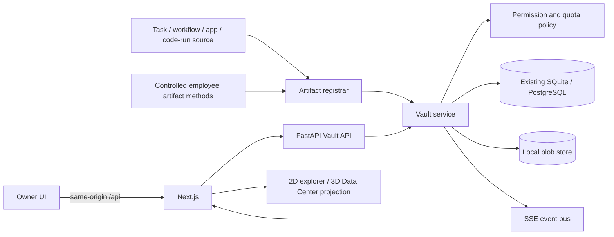

# NEXUS AI — Data Center & Digital Vault

This document is the architecture and delivery tracker for the **Data Center & Digital
Vault** feature. It is a separate, approval-gated feature track named **DC-1** through
**DC-8** so that it cannot be confused with NEXUS AI's existing 16-stage roadmap.

> **Current status:** DC-8, the last stage of this track, was completed on 2026-10-11.
> The global product remains at **Stage 10 of 16**, with
> Stage 11 unapproved. The 3D room, live metadata projection, owner file APIs, responsive
> Vault browser, automatic registration of real employee artifacts, version history with
> comparison and restore, the engineering project viewer, the storage dashboard, verified
> backups with repair and recovery, integrity maintenance and browser sharing are
> operational.

## Product contract

The completed feature will provide persistent, backend-managed artifacts for every
department and expose them through both a professional 2D file explorer and an
interactive 3D server room. The following rules apply to every DC stage:

- File names, contents, counts, sizes, quotas and activity must come from real backend
  state. Decorative racks and LEDs are never evidence of a storage operation.
- Binary contents live in a storage backend; searchable metadata and relationships live
  in the existing database. The browser is never the system of record.
- Department workspaces are derived from the `departments` table, not from a hardcoded
  list. A future department must receive the same storage behavior automatically.
- The frontend receives opaque IDs and safe metadata, never arbitrary server paths or
  storage keys.
- Uploading or previewing a file never executes it. Generated applications continue to
  use the existing owner-approved Bubblewrap runtime.
- Permissions, quotas, approvals and permanent deletion are enforced in backend code.
- Local storage is the first supported backend. S3-compatible and network storage are
  extension points, not features that are currently claimed.

## Feature stage tracker

Only one DC stage may be executed at a time. Each stage must be implemented, tested and
reported, then stop for the owner's approval before the next one begins.

| ID | Scope | Status |
| --- | --- | --- |
| DC-1 | Project inspection, storage architecture, configuration and schema foundation | ✅ Complete |
| DC-2 | Visible 3D Data Center room, 2D fallback and backend-connected read-only overview | ✅ Complete |
| DC-3 | Real storage backend: upload, download, folders, rename, move, trash and validation | ✅ Complete |
| DC-4 | Dynamic department workspaces, quotas, permissions and task/app associations | ✅ Complete |
| DC-5 | Professional file explorer, search, previews, metadata and ZIP export | ✅ Complete |
| DC-6 | Automatic registration of real AI employee artifacts | ✅ Complete |
| DC-7 | Engineering project viewer, immutable versions, restore, diffs and dashboards | ✅ Complete |
| DC-8 | Backup/recovery, integrity, permission boundaries, performance and final polish | ✅ Complete |

DC stages do not advance `CURRENT_STAGE` in `frontend/src/lib/stages.ts` and do not
approve global Stage 11. If the owner later replaces or reschedules the 16-stage plan,
that is a separate explicit decision.

## Existing systems to preserve

The Vault must integrate with the current sources of real files rather than create a
parallel demo system:

| Existing source | Current persistence | DC integration decision |
| --- | --- | --- |
| Chat attachments | Bytes and decoded text in the `attachments` table; 2 MiB limit | The registrar copies the real bytes into the conversation department workspace without changing chat history and preserves a message link. |
| Engineering apps | Versioned text in `app_files`; runtime materialized under `NEXUS_APPS_DIR` | `App` and `AppVersion` are the current engineering project aggregate. Vault links must retain app and version provenance. |
| Code-run outputs | Files under `NEXUS_RUNS_DIR/<run id>/files` plus metadata on `code_runs` | Register only files that really exist and retain the originating run/task/employee. |
| Tasks and workflows | Database-backed tasks, assignees, departments and results | Artifacts link to their real task and creator; failed generation creates no fake successful file. |
| Departments | Twenty seeded rows in the `departments` table | Workspaces are provisioned from database rows and remain dynamic. |

There is no general `Project` model yet; it belongs to global Stage 11. DC-1 therefore
must not introduce a competing project system. Initial links use the existing `Task`
and engineering `App`/`AppVersion` records. A proper project foreign key can be added
when the canonical project model exists.

## Architecture

The service layer is the only component allowed to combine metadata and blob
operations. API routes, agent tools and future background jobs all call the same
service and policy checks.

### Configuration contract

DC-1 implements the following server-side environment variable names. All sizes are
bytes so configuration is unambiguous.

| Variable | Default | Purpose |
| --- | --- | --- |
| `NEXUS_STORAGE_BACKEND` | `local` | Selected blob backend. DC-1 accepts only `local`; unsupported values must fail configuration instead of pretending cloud storage works. |
| `NEXUS_STORAGE_ROOT` | `backend/var/storage` | Private root for temporary and committed blobs. It is ignored by git. |
| `NEXUS_STORAGE_MAX_FILE_BYTES` | `104857600` (100 MiB) | Hard per-file upload/write limit, enforced while streaming. |
| `NEXUS_STORAGE_DEPARTMENT_QUOTA_BYTES` | `10737418240` (10 GiB) | Default logical quota per department; it does not reserve disk space. |
| `NEXUS_STORAGE_ALLOWED_EXTENSIONS` | The documented initial file types | Comma-separated extension policy. MIME and extension are advisory metadata; neither authorizes execution. |
| `NEXUS_STORAGE_BACKUP_ROOT` | unset | Optional local backup destination. Unset means backups are not configured. A folder on the same drive is not described as disaster recovery. |
| `NEXUS_STORAGE_BACKUP_KEEP` | `7` | Number of backups kept (1–365). Older ones are removed after a successful backup. |

`NEXUS_STORAGE_ROOT` and `NEXUS_STORAGE_BACKUP_ROOT` must be distinct and must not be
nested inside one another. A maximum file size cannot exceed the department quota.
Secrets never belong in these settings or in file metadata returned to the browser.

### Metadata schema foundation

Migration `0013_storage_foundation` adds the structures without creating or copying
user files:

- **`storage_workspaces`** — one company workspace plus one row for every department
  selected from the real registry during migration. The department foreign key is
  unique and restrictive, with optional quota override and active/read-only state.
- **`storage_entries`** — logical folders/files with opaque IDs, workspace/parent,
  case-preserving path, NFKC/case-folded `path_key`, type, description, visibility,
  creator/owner snapshots, current version number, failure state and Trash metadata.
  `(workspace_id, path_key)` is unique, avoiding nullable-root uniqueness differences.
- **`storage_versions`** — version records with `(entry, number)` uniqueness, opaque
  storage key, byte size, SHA-256, MIME type, change description, creator and integrity
  state. Blob creation itself begins in DC-3.
- **`storage_links`** — idempotent provenance links to tasks, workflows, apps, app
  versions/files, code runs, messages and the future canonical project model.
- **`storage_tags`** — normalized, case-insensitive tag keys for portable search.
- **`storage_grants`** — department/employee read, write or manage grants with grantor,
  expiry and revocation history, enforced by the service layer in DC-4.
- **`storage_events`** — append-only audit/failure records whose actor snapshots survive
  employee or artifact removal.

The models and migration stay in the existing Alembic single-head sequence and are
covered by drift plus upgrade/downgrade testing.

### Blob layout and atomic writes

Department and original file names are metadata, not operating-system paths. Local
blobs use opaque keys below the configured root. A write is designed to:

1. stream into a uniquely named temporary file while enforcing the size limit;
2. calculate the checksum without loading the whole file into memory;
3. flush and atomically rename the complete blob into its final opaque location;
4. commit the corresponding metadata/version/event transaction; and
5. leave a failed operation unavailable to users and eligible for safe orphan cleanup.

The filesystem and SQL database cannot share one atomic transaction. Immutable blobs,
explicit operation states and reconciliation make that boundary observable instead of
silently reporting success. No download endpoint accepts a filesystem path. DC-1's
logical-name layer rejects absolute paths, drive/UNC paths, `..` and NUL bytes; DC-3's
local backend must additionally reject symbolic-link traversal.

### Permission boundary

NEXUS currently has no login or multi-user identity system. Browser requests are
treated as the local company owner, and opt-in LAN mode already warns that anyone on
the trusted network can use the application. Consequently:

- DC stages can enforce owner-versus-agent permissions and department scoping inside
  the backend service.
- Agent tools receive an internal actor context; callers cannot choose an arbitrary
  employee ID to impersonate.
- Full human multi-user RBAC and safe use on an untrusted network require a future
  authentication decision. They must not be claimed merely because buttons are hidden.
- Finance, HR, Legal and Sales data remain restricted from unrelated agents by backend
  policy. Preview/search/model-context operations use the same policy as downloads.

Permanent deletion and cross-department sharing are audited, backend-gated actions.
Normal deletion moves an item to Trash. Private storage keys and absolute locations are
never included in API responses, logs or model prompts.

## UI direction from the supplied reference

The owner-supplied **Web App Sandbox Interface Overview** is a visual reference, not a
completed NEXUS screen. DC-2 begins applying its visual language; future DC-5/DC-7 work
should carry forward these qualities:

- a premium dark workspace with restrained blue-to-purple accents and high-contrast
  typography consistent with the existing NEXUS design tokens;
- a persistent tree/navigation pane, a focused main workspace and a dedicated preview
  or metadata pane rather than overlapping modal windows;
- unmistakable status badges such as **Isolated**, **Online**, **Ready** or **Failed**,
  backed by real backend state;
- a short, visible lifecycle from upload/create through validation and preview to a
  deliberate download or release action;
- prominent safety context and compact operational controls, with destructive actions
  separated from ordinary navigation;
- polished empty, loading, unavailable and failure states instead of sample files or
  fabricated terminal output.

The Vault adapts that composition to storage: the left side becomes All Files,
Departments, Projects, Recent, Favorites, Shared, Archives and Trash; the center uses
grid/list browsing; the right side shows safe preview, metadata, versions, provenance
and activity. On smaller screens the 2D explorer remains usable without the 3D room.

The reference's live browser preview and terminal are shown only for a real engineering
app running through the existing isolated runtime. An ordinary uploaded HTML or SVG is
never executed to make the interface look functional. If no runtime exists, the UI
says **Preview unavailable — runtime not configured.**

## DC-1 verification

All checks ran in the isolated `~/nexus-ai-dev` WSL copy with temporary databases and
storage roots; the owner's running `~/nexus-ai` data and real providers were not used.

| Check | Result |
| --- | --- |
| Storage configuration, logical paths and migration foundation | **PASS** — 25 tests |
| Complete backend suite | **PASS** — 246 passed, 4 skipped |
| Backend Ruff; frontend ESLint and TypeScript | **PASS** |
| Frontend unit suite | **PASS** — 183 tests |
| Next.js production build | **PASS** — 20 routes generated |
| Isolated full-stack smoke test | **PASS** — pages, APIs, proxy failure and SSE |
| Playwright browser suite | **FAIL** — 51 passed; the existing employee walk test stayed `walking` instead of reaching `away` under software GL. The isolated test failed the same way on a second run; normal GPU flags could not initialize the WSL office. No DC-1 frontend/3D code changed. |

DC-3 adds streaming size/quota enforcement, atomic blob commits, missing/corrupt blob
reconciliation and symlink-safe local storage tests; DC-1/DC-2 did not claim those file
operations existed.

## DC-2 implementation

- Level 2 now contains a dedicated **Data Center** beside Engineering, separated by a
  glass wall and enterable door. It is part of the same room model, camera controls,
  room search, accessible 2D plan and responsive details panel as every other room.
- Twelve rack meshes form the physical room. Their lighting is explicitly ambient; it
  does not claim per-rack health or storage activity.
- `GET /api/storage/overview` returns aggregate workspace, entry, version, byte, quota,
  backup-configuration and latest-event facts from the real database and settings. It
  never returns file names, contents, storage keys or server paths.
- The room panel shows loading, live, empty and backend-unavailable states. The Digital
  Vault action is visibly disabled because file operations do not exist yet.
- Engineering retains all twelve workstation IDs and therefore preserves existing
  employee desk assignments while fitting within its resized room.

## DC-2 verification

Backend and full-stack verification runs in the isolated WSL development copy with
temporary databases, storage roots and fake providers. Frontend-only checks run from
the shared working tree.

| Check | Result |
| --- | --- |
| Storage overview and storage-foundation tests | **PASS** — 27 tests |
| Complete backend suite | **PASS** — 248 passed, 4 skipped |
| Backend Ruff; frontend ESLint and TypeScript | **PASS** |
| Frontend unit suite | **PASS** — 188 tests |
| Next.js production build | **PASS** — 21 routes generated |
| Isolated full-stack smoke test | **PASS** — including direct and proxied storage overview |
| Data Center browser flow and screenshot | **PASS** — room selection, live metadata, read-only states and disabled file operations |
| Full Playwright browser suite | **PARTIAL** — 52 passed and 2 failed on the first full software-GL run. The new character-click regression was fixed and its focused rerun passed. The remaining pre-existing suspended-walk test again stayed `walking` instead of reaching `away`; its exact isolated rerun failed identically. |

## DC-3 implementation

`VaultService` is now the transaction boundary for owner file operations, and
`LocalBlobStore` is the only component that handles local object paths. The API surface
is intentionally backend-first so DC-4 permissions and DC-5's explorer can use the same
enforced operations instead of duplicating storage logic.

| Route | Behavior |
| --- | --- |
| `GET /api/storage/workspaces` | Real workspace usage, state and effective quota |
| `GET /api/storage/workspaces/{id}/entries` | Safe logical entry metadata; never storage keys or server paths |
| `POST /api/storage/workspaces/{id}/folders` | Create a validated logical folder |
| `POST /api/storage/workspaces/{id}/files` | Stream and atomically commit one allowlisted upload |
| `GET /api/storage/entries/{id}/download` | Revalidate size/SHA-256 and stream with `nosniff` |
| `PATCH /api/storage/entries/{id}` | Rename or move a file/folder and update descendant paths |
| `DELETE /api/storage/entries/{id}` | Move the complete logical subtree to Trash without deleting blobs |
| `POST /api/storage/entries/{id}/restore` | Restore a trashed subtree when its parent is available |
| `POST /api/storage/maintenance/reconcile` | Mark missing/corrupt versions and report orphaned/unsafe objects without deleting uncertain data |

Uploads stream to a unique private temporary file, enforcing the lower of the per-file
limit and remaining workspace quota while computing SHA-256. The completed file is
flushed and atomically moved to an internally generated key before metadata, version and
audit rows commit together. A failed metadata commit removes the new blob; interrupted
or oversized streams remove their temporary file. Reconciliation covers the unavoidable
filesystem/database crash boundary.

Logical paths remain NFKC-normalised and case-insensitively unique. The local backend
accepts only generated key shapes, refuses symbolic links and non-regular files, and
never follows a browser path. Read-only workspace state, extension policy, folder-cycle
prevention, byte limits and quota limits are enforced in the service rather than the UI.

The Data Center panel now reports that the storage owner API is operational while its
disabled action accurately says the browser explorer is planned for DC-5.

## DC-3 verification

Backend and full-stack verification use the isolated WSL development copy with temporary
databases, storage roots and fake providers. Frontend-only checks use the shared working
tree.

| Check | Result |
| --- | --- |
| Storage lifecycle, limits, integrity and symlink tests | **PASS** — 15 focused tests |
| Complete backend suite | **PASS** — 255 passed, 4 skipped |
| Backend Ruff; frontend ESLint and TypeScript | **PASS** |
| Frontend unit suite | **PASS** — 188 tests |
| Next.js production build | **PASS** — 21 routes generated |
| Isolated full-stack smoke test | **PASS** — real upload, byte-identical download and Trash plus pages, proxy, SSE and backend-down behavior |
| Clean-checkout setup, migrations and smoke test | **PASS** — reproduced from the exact staged tree with fresh dependencies and database |
| Data Center browser flow and screenshot | **PASS** — visible room, real metadata, operational-owner-API state and honest disabled explorer |
| Full Playwright browser suite | **PARTIAL** — 53 passed and the same pre-existing suspended-walk test failed under software GL because the employee remained `walking` instead of reaching `away`. All Data Center, desktop, mobile and no-WebGL tests passed. |

## DC-4 implementation

- Workspace synchronization idempotently creates `ws_company` and a stable workspace
  for every real department at startup and before workspace/overview reads. Departments
  added while the app is running therefore receive the same behavior without a code or
  migration edit.
- The owner can set a workspace quota override or active/read-only state. A quota cannot
  be lowered below recorded usage, and uploads continue to enforce the effective quota
  while streaming.
- `StorageActor` is a trusted service-layer identity. Employees are resolved from the
  database, can read/write their own department workspace and read the company workspace,
  and cannot access another department without an active grant. Workspace and subtree
  grants support read/write/manage levels, employee or department grantees, expiry and
  audited revocation.
- HTTP routes remain the local owner surface because human authentication does not yet
  exist. No request header or body can impersonate an employee; future agent tools must
  use the internal employee resolver and the same enforced service methods.
- Artifact links validate real `Task`, `App` or `AppVersion` rows. Department task links
  must match the workspace; app links are limited to company or Engineering workspaces.
  Links are idempotent and file links capture the current immutable version.
- The Data Center projection now includes active access grants, linked artifact count and
  read-only workspace count. The full explorer remains honestly disabled until DC-5.

### DC-4 owner routes

| Route | Behavior |
| --- | --- |
| `PATCH /api/storage/workspaces/{id}` | Set an optional quota override and active/read-only state |
| `GET/POST /api/storage/workspaces/{id}/grants` | List or create scoped employee/department grants |
| `DELETE /api/storage/grants/{id}` | Audit and revoke a grant without erasing history |
| `GET/POST /api/storage/entries/{id}/links` | List or create validated task/app provenance links |

## DC-4 verification

All backend and full-stack checks ran in the isolated `/root/nexus-ai-dev` WSL copy with
temporary databases, storage roots and fake providers. Frontend checks used the Linux
Node toolchain so Windows application-control policy could not block native packages.

| Check | Result |
| --- | --- |
| DC-4 workspace, quota, permission, grant and association tests | **PASS** — 13 storage tests |
| Complete backend suite | **PASS** — 259 passed, 4 skipped |
| Backend Ruff; frontend ESLint and TypeScript | **PASS** |
| Frontend unit suite | **PASS** — 188 tests |
| Next.js production build | **PASS** — 21 routes generated |
| Isolated full-stack smoke test | **PASS** — direct/proxied APIs plus real upload, byte-identical download and Trash |
| Clean-checkout setup, migrations and smoke test | **PASS** — reproduced from the exact staged tree with fresh database/storage |
| Data Center focused browser flow and screenshot | **PASS** — visible room, live grant/link counts and honest DC-5 explorer state |
| Full Playwright browser suite | **PARTIAL** — 53 passed and the same pre-existing suspended-walk test failed under software GL because the employee remained `walking` instead of reaching `away`. The Data Center and all other desktop, mobile and no-WebGL tests passed. |

## DC-5 implementation

- `/vault` is a real, responsive three-pane browser connected to the permission-enforced
  Vault service. Its left pane exposes All files, Recent, Favorites, Trash and every
  dynamically provisioned workspace; the center pane provides folder navigation,
  incremental results, search, type filter, sorting and grid/list modes; the inspector
  exposes safe preview, editable metadata, versions, provenance links and audit activity.
- File and folder controls cover create, upload, verified download, rename, description,
  tags, favorite, move, immutable-blob duplicate/copy, multi-select ZIP export, Trash,
  restore and confirmed permanent deletion. Empty states remain honest and never insert
  sample files.
- Metadata search is bounded and permission filtered. It matches logical names/paths,
  descriptions, owners/creators, tags, links, workspace/department keys and MIME types,
  with deterministic sorting and pagination.
- Text, code, CSV, HTML and SVG are previewed only as bounded escaped text. Supported
  raster image, PDF, audio and video bytes are streamed inline with `nosniff`, no-store
  and restrictive CSP headers. Office and unknown formats provide metadata and verified
  download without attempting execution.
- ZIP export accepts 1–100 selections, expands no more than 5,000 accessible entries,
  uses logical workspace-relative paths, validates every download and streams from a
  spooled temporary handle. It never exposes backend paths or stores the archive as a
  Vault artifact.
- The Data Center panel and the persistent application navigation both open `/vault`.
  On phones, the workspace navigator is bounded and scrollable so the file browser stays
  reachable without horizontal overflow.

### DC-5 owner routes

| Route | Behavior |
| --- | --- |
| `GET /api/storage/search` | Permission-filtered metadata search, filters, sorting and bounded pagination |
| `GET /api/storage/entries/{id}` | Entry metadata, tags/favorite, current versions, links and recent activity |
| `GET /api/storage/entries/{id}/preview` | Bounded safe-text or restricted inline-media preview |
| `PATCH /api/storage/entries/{id}` | Rename/move plus description, artifact type and normalized tags |
| `POST /api/storage/entries/{id}/duplicate` | Copy a file or complete folder subtree using new immutable blobs |
| `POST /api/storage/export` | Stream a temporary ZIP for selected accessible entries |
| `DELETE /api/storage/entries/{id}/permanent?confirm=true` | Permanently remove an item already in Trash and its blobs |

## DC-5 verification

Backend and full-stack checks run only in the isolated `/root/nexus-ai-dev` WSL copy
with temporary databases and storage roots. Visual artifacts are copied back to
`.artifacts/e2e/` for manual inspection. Final verification results are recorded below
after the staged-tree reproduction.

| Check | Result |
| --- | --- |
| DC-5 search, preview, copy, ZIP and deletion tests | **PASS** — 3 focused tests; 16 combined storage tests |
| Complete backend suite | **PASS** — 262 passed, 4 skipped |
| Backend Ruff; frontend ESLint and TypeScript | **PASS** |
| Frontend unit suite | **PASS** — 189 tests |
| Next.js production build | **PASS** — 22 routes generated |
| Isolated full-stack smoke test | **PASS** — search, preview, ZIP, download, Trash and permanent deletion plus existing checks |
| Clean staged-tree setup, migrations and smoke test | **PASS** — fresh dependencies, database and storage reproduced from the staged files |
| Focused browser workflow | **PASS** — complete file lifecycle and no console/HTTP errors |
| Mobile browser check | **PASS** — no horizontal overflow; bounded workspace navigator |
| Visual inspection | **PASS** — desktop and phone screenshots reviewed |
| Full Playwright browser suite | **PARTIAL** — 55 passed; the same pre-existing suspended-walk test failed under software GL because the employee remained `walking` instead of reaching `away`. Every Vault, Data Center, mobile and no-WebGL test passed. |

## DC-6 implementation

- `ArtifactRegistrar` is the idempotent integration boundary between existing domain
  records and the Vault. It never replaces the source record and never accepts an
  operating-system path from an employee or browser.
- Completed manual and workflow tasks are stored as Markdown in their real department
  workspace. Final CEO workflow reports are stored in the company workspace. Creator,
  department, task and workflow identity remain in metadata and validated links.
- Every `written` `AppFile` in a ready version is copied into Engineering under
  `AI Artifacts/Apps/<app>/Version <n>/...`, preserving its logical source tree and links
  to the app, version and individual app-file row. Unsupported source suffixes are kept
  as inert text rather than executed.
- Code-run outputs are registered only when the metadata-listed file exists as a regular,
  non-symbolic-link child of that run's private output folder. Run, task/message and
  employee provenance is retained. A missing, unsafe or unregistrable claimed output
  creates `artifact_registration_failed` at error level and no fake file.
- Owner chat attachments retain the `attachments` table as their source of truth and are
  registered as distinct source artifacts in the conversation department. Repeated file
  names remain distinct through their stable attachment IDs and are not tagged as AI
  generated.
- Changed source bytes append an immutable Vault version. Repeating the same registration
  does not duplicate bytes or links. Startup recovery scans completed persisted records,
  so eligible pre-DC-6 artifacts are backfilled safely after deployment.
- The controlled employee interface provides save, list, read, update, create-folder,
  search and link methods. It derives the only writable workspace from the database
  employee identity, applies normal Vault policy, and exposes opaque IDs rather than
  storage keys or filesystem locations.
- `/vault` now includes an **AI generated** view backed by the real `ai-generated` tag.
  Generated-view creation/upload actions are disabled because manual uploads must not be
  misrepresented as employee output. The inspector shows the real preview, immutable
  versions, creator and expanded task/workflow/app/file/run/message provenance.
- App builds may become visible as ready before their artifact copy returns. The app
  driver now queues a requested next version behind that finishing driver, preventing a
  real change request from becoming stranded in `planning`.

### DC-6 source mapping

| Source | Vault destination | Primary provenance |
| --- | --- | --- |
| Completed task result | Department / `AI Artifacts/Tasks` | `task:result` |
| Completed workflow report | Company / `AI Artifacts/Workflows` | `workflow:report` |
| Ready app version files | Engineering / `AI Artifacts/Apps/.../Version n` | `app_file:source`, plus app and version |
| Real code-run output | Producing department / `AI Artifacts/Code Runs/<run>` | `code_run:output-*`, plus task/message |
| Chat attachment | Conversation department / `AI Artifacts/Chat Attachments/<conversation>` | `message:attachment-*` |

## DC-6 verification

All backend, browser and full-stack execution used the isolated `/root/nexus-ai-dev`
WSL copy, temporary databases/storage roots and fake providers. The owner's running
installation and real provider credentials were not used.

| Check | Result |
| --- | --- |
| DC-6 source, version, failure and controlled-tool tests | **PASS** — 4 focused tests |
| Automatic completed-task integration | **PASS** — real fake-provider result, employee attribution, task link and byte-identical download |
| Complete backend suite | **PASS** — 266 passed, 4 skipped |
| Backend Ruff; frontend ESLint and TypeScript | **PASS** |
| Frontend unit suite | **PASS** — 189 tests |
| Next.js production build | **PASS** — 22 routes generated |
| Isolated full-stack smoke test | **PASS** — direct/proxied APIs and complete existing Vault lifecycle |
| Clean staged-tree setup, migrations and smoke test | **PASS** — fresh database/storage reproduced from exactly staged files |
| Focused DC-6 browser workflow | **PASS** — completed employee task appeared in **AI generated** with preview and task provenance |
| Visual inspection | **PASS** — `digital-vault-dc6-generated.png` reviewed at 1440×900 |
| Full Playwright browser suite | **PARTIAL** — 56 passed; the same pre-existing suspended-walk test failed under software GL because the employee remained `walking` instead of reaching `away`. Every Vault, Data Center, mobile and no-WebGL test passed. |

## DC-7 implementation

- **Immutable version history.** Every version of a file keeps its own number, bytes,
  checksum, creator and change note. Any version can be downloaded or previewed through
  the same size/SHA-256 validation as the current one, and an older version stays
  readable while the newest one is missing or corrupt. No route edits or removes a
  single version.
- **New versions by hand.** The owner can upload new content as the next version of a
  file they manage. The upload must be the same type of file, counts against the
  workspace quota, and identical content is refused instead of creating an empty step.
- **Restore.** Restoring version *n* appends a verified copy of it as the newest
  version with the note "Restored from version *n*." and an audit event. Earlier versions
  are never rewritten. Restoring the current version, restoring identical content,
  restoring from Trash or restoring an unavailable version is refused.
- **Mirrored artifacts stay read-only.** A file registered by `ArtifactRegistrar` (task
  result, workflow report, app source, code-run output, chat attachment) follows its
  source record. Its history can be viewed, compared and downloaded, but a manual upload
  or restore is refused with 409, so employee work is never replaced by something else
  under the same name. The detail response reports this as `source_managed`.
- **Reserved provenance relations.** Only the registrar may create the links that mark a
  file as a source record's output (`task:result`, `workflow:report`, `app_file:source`,
  `code_run:output-*`, `message:attachment-*`). The owner API and the controlled employee
  `link` method are refused with 422, which closes a way to attach an unrelated file to
  a task and have the task's result appended to it.
- **Comparison.** `VaultInsights.diff` compares two stored versions — of one file, or of
  two different files — from their validated bytes and returns numbered added, removed
  and context lines. It is bounded: text files only, at most 512 KiB and 20,000 lines per
  side, and at most 2,000 returned lines while the added/removed totals stay complete.
  Binary, oversized and identical inputs and line-ending-only changes are reported as
  such rather than shown as an empty result.
- **Engineering project viewer** (`/vault/projects`). The current engineering project
  aggregate is the real `App` with its `AppVersion` rows. For each finished version the
  viewer lists the written files, their author, size and Vault state, and marks each as
  added, modified or unchanged against the version it was built on (from the real file
  contents), plus the files that were removed. A stored file can be read, downloaded and
  compared with its previous version; a version folder can be exported as a ZIP.
  Versions that are not ready, and files that are not stored or are in Trash, are shown
  as exactly that.
- **Storage dashboard** (`/vault/dashboard`). Totals, usage and quota per workspace,
  files by artifact type and by who created them, employees with the most stored files,
  events per day for the last 14 days in the viewer's time zone, recent activity and the
  count of failed registrations all come from one read of the database. Empty sections
  say "Not enough data"; nothing is estimated. An employee actor only receives the
  workspaces it may read.
- The Data Center room panel links to both new screens, and the three Vault screens
  share one section bar.
- **Fix found during verification.** Deleting an app in the instant it became ready
  cancelled the DC-6 copy to the Vault in the middle of a write, which could leave
  SQLite locked and fail the delete with a 500 (reproduced about once in 20 runs under
  load). The app builder now lets that copy finish before a delete, cancel or change
  request proceeds; `test_deleting_an_app_waits_for_its_copy_to_the_vault` covers it.

### DC-7 owner routes

| Route | Behavior |
| --- | --- |
| `GET /api/storage/entries/{id}/download?version=n` | Validated download of one named version |
| `GET /api/storage/entries/{id}/preview?version=n` | Bounded safe preview of one named version |
| `POST /api/storage/entries/{id}/versions` | Upload new content as the next version (not for mirrored artifacts) |
| `POST /api/storage/entries/{id}/versions/{n}/restore` | Append a verified copy of version *n* as the newest version |
| `GET /api/storage/diff` | Bounded line comparison of two stored versions |
| `GET /api/storage/projects` | Engineering apps with their stored version, file and byte counts |
| `GET /api/storage/projects/{app_id}` | Versions, stored files, authors and changes between versions |
| `GET /api/storage/dashboard` | Totals, usage, composition, daily activity and recent events |

## DC-7 verification

All backend, browser and full-stack execution used the isolated `/root/nexus-ai-dev`
WSL copy, temporary databases/storage roots and fake providers. The owner's running
installation and real provider credentials were not used.

| Check | Result |
| --- | --- |
| DC-7 version, restore, recovery, comparison, mirror, project and dashboard tests | **PASS** — 6 focused tests |
| Complete backend suite | **PASS** — 273 passed, 4 skipped |
| Backend Ruff; frontend ESLint and TypeScript | **PASS** |
| Frontend unit suite | **PASS** — 199 tests |
| Next.js production build | **PASS** — 24 routes generated |
| Clean-copy setup, migrations and full-stack smoke test | **PASS** — run after the commit, on a fresh copy of the committed tree with its own database, storage root and ports: all 14 migrations, then every smoke check including new version, comparison, restore, dashboard and project routes. The owner had asked for the commit and push before this check was run. |
| Focused DC-7 browser workflows | **PASS** — version upload/compare/restore; a real two-version app in the project viewer; dashboard totals equal to the API |
| Mobile browser check | **PASS** — dashboard and project viewer without horizontal overflow |
| Visual inspection | **PASS** — versions, projects and dashboard screenshots reviewed on desktop and phone |
| Full Playwright browser suite | **PARTIAL** — 59 passed; the same pre-existing suspended-walk test failed under software GL because the employee remained `walking` instead of reaching `away`. Every Vault, Data Center, mobile and no-WebGL test passed. This run was on the committed code and finished after the commit. An earlier run had also failed the DC-5 Vault workflow, whose `Download` link locator had become ambiguous next to the new `Download v1` link; that locator was made exact. |

## DC-8 implementation

- **Backups** (`backend/app/storage/backup.py`, `VaultBackup`). A snapshot copies every
  stored version into `NEXUS_STORAGE_BACKUP_ROOT`, named by its SHA-256 so unchanged
  content is stored once across snapshots. Each copy is published only if it matches the
  recorded size and checksum. The snapshot's manifest holds the Vault's workspaces,
  folders, files, versions, tags and provenance links, and has a checksum of its own. A
  version whose bytes could not be read is listed as not saved and the snapshot is marked
  **partial**; it is never reported as complete. Storage keys and server paths are not in
  the manifest or in any response.
- **Verification.** Verifying a snapshot re-reads every object it refers to. A missing
  or altered object, or an altered manifest, fails verification and is shown as failed.
- **Repair.** `repair` runs an integrity check and then, for each version whose bytes
  are missing or corrupt, writes the backup copy into the Vault as a new object, checks
  it and points the version at it. Versions the backups never held stay unavailable and
  are counted as such.
- **Recovery of deleted files.** A snapshot lists the files it holds that no longer
  exist in the Vault. Recovering one re-creates its newest content as a new file under
  `Recovered from backup` in its original workspace, after verifying the backup copy.
  Nothing is replaced; the list then shows where that content now is.
- **Retention.** After a successful backup only the newest `NEXUS_STORAGE_BACKUP_KEEP`
  snapshots are kept, and objects no remaining snapshot refers to are removed. If any
  remaining manifest is unreadable, no object is removed.
- **Truthful state.** The backup folder is reported as on the same drive as the Vault
  when it is, with the plain statement that this does not protect against losing the
  drive. Without a configured folder every backup route answers 409 and the UI says
  backups are off. One backup operation runs at a time; a second gets 409.
- **Integrity.** `reconcile` now works through versions in batches of 500 and takes the
  object inventory before reading the keys, so a file committed meanwhile is not counted
  as unreferenced. `GET /maintenance/integrity` returns the last check and the damaged
  versions. `cleanup` removes unreferenced objects and interrupted upload fragments only
  after the owner confirms, and only when they are more than an hour old, because an
  upload stores its bytes before its metadata.
- **Sharing.** The grant model from DC-4 is now usable from the browser: an item's
  details list who can reach it (directly, through a folder above, or through the whole
  workspace) and can share it with a department or one employee, to read or to read and
  change, with an optional 7- or 30-day expiry. A **Shared** view lists shared items and
  the Protection screen lists and revokes every grant. Granting a department access to
  its own workspace and sharing an item in Trash are refused.
- **Permission boundaries.** Tests now cover an outside employee on every read path
  (details, download, preview, export, comparison, folder listing, links, search and
  dashboard) before a grant, with a folder-scoped read grant, after it expires and for
  write attempts. Backup, repair, integrity and cleanup are owner-only in the service.
- **Performance.** Folder listings and search results read their versions and tags in
  two queries per batch instead of two per item; a test asserts that 60 files take the
  same number of queries as 5. Workspace usage is one grouped query, and a subtree is
  selected by path prefix instead of loading the whole workspace.
- **Protection screen** (`/vault/protection`) and the Data Center room panel show the
  last backup, the last integrity check and the number of unavailable versions.

### DC-8 owner routes

| Route | Behavior |
| --- | --- |
| `GET /api/storage/backups` | Whether backups are configured, same-drive state, retention and the snapshots with their last verification |
| `POST /api/storage/backups` | Take a snapshot (409 when not configured or another operation is running) |
| `POST /api/storage/backups/{id}/verify` | Re-read every object of one snapshot against its checksum |
| `GET /api/storage/backups/{id}/deleted` | Files the snapshot holds that are no longer in the Vault |
| `POST /api/storage/backups/{id}/recover` | Re-create one deleted file as a new file |
| `GET /api/storage/maintenance/integrity` | Last check and the versions currently damaged |
| `POST /api/storage/maintenance/repair` | Check integrity, then restore damaged versions from the backups |
| `POST /api/storage/maintenance/cleanup` | Remove old unreferenced objects; requires `{"confirm": true}` |
| `GET /api/storage/grants[?entry_id=]` | Live sharing grants with names; with an item, the ones that reach it |
| `GET /api/storage/search?shared=true` | Items shared by name |

## DC-8 verification

All backend, browser and full-stack execution used isolated WSL copies with temporary
databases, storage and backup folders and fake providers. The owner's running
installation and real provider credentials were not used.

| Check | Result |
| --- | --- |
| DC-8 backup, verification, repair, recovery, retention, cleanup, sharing-boundary and query-count tests | **PASS** — 10 focused tests |
| Complete backend suite | **PASS** — 283 passed, 4 skipped |
| Backend Ruff; frontend ESLint and TypeScript | **PASS** |
| Frontend unit suite | **PASS** — 204 tests |
| Next.js production build | **PASS** — 25 routes generated |
| Clean staged-tree setup, migrations and full-stack smoke test | **PASS** — fresh database, storage and backup folders; every check including backup created and verified, a permanently deleted file recovered from it, integrity and sharing routes |
| Focused DC-8 browser workflows | **PASS** — back up, verify, lose a stored object on disk, detect it, repair it, recover a deleted file; share a folder, find it under Shared, revoke it |
| Mobile browser check | **PASS** — Protection screen without horizontal overflow |
| Visual inspection | **PASS** — Protection (healthy and damaged), sharing panel and phone screenshots reviewed |
| Full Playwright browser suite | **PARTIAL** — 62 passed; the same pre-existing suspended-walk test failed under software GL because the employee remained `walking` instead of reaching `away`. Every Vault, Data Center, mobile and no-WebGL test passed. |
| Secret and private-path scan of the changed files | **PASS** |

## Current limitations

- HTTP routes act as the local company owner because NEXUS has no human authentication
  system. Internal employee artifact methods are permission checked, but they are not a
  substitute for future human multi-user authentication.
- A backup covers Vault files and their metadata only. The application database (chats,
  tasks, employees, settings) is not included, and a snapshot cannot rebuild the Vault's
  database: repair needs the version's metadata row to exist, and recovery of a deleted
  file restores its newest content only, not its history, tags or links.
- Backups are taken when the owner asks; there is no schedule. A backup folder on the
  same drive does not protect against losing the drive.
- Creating a backup trusts an object already in the backup folder by its name and size;
  only **Verify** re-reads its bytes.
- The responsive browser file explorer is implemented; per-rack health and a writable
  room dashboard are not.
- Eligible existing chat attachments, ready app files, completed task/workflow results
  and real code-run outputs are registered by startup recovery. Failed/incomplete source
  records remain source records and do not become successful Vault files.
- Comparison is line based and text only; images, PDFs and office files report their
  sizes and checksums but are not compared. An app version cannot be rolled back from
  the Vault: changing an app remains a change request in Apps.
- The dashboard is read on demand, not pushed live; it has a Refresh button.
- Integrity checks are run by the owner, not on a timer. A grant applies to employee
  actors inside NEXUS; there are no share links for people outside it.
- The only implemented blob backend is local disk. Backup health is unknown while
  `NEXUS_STORAGE_BACKUP_ROOT` is unset.
- A canonical Project model and human authentication do not yet exist. The integrations
  above deliberately preserve those boundaries rather than fabricate them.
